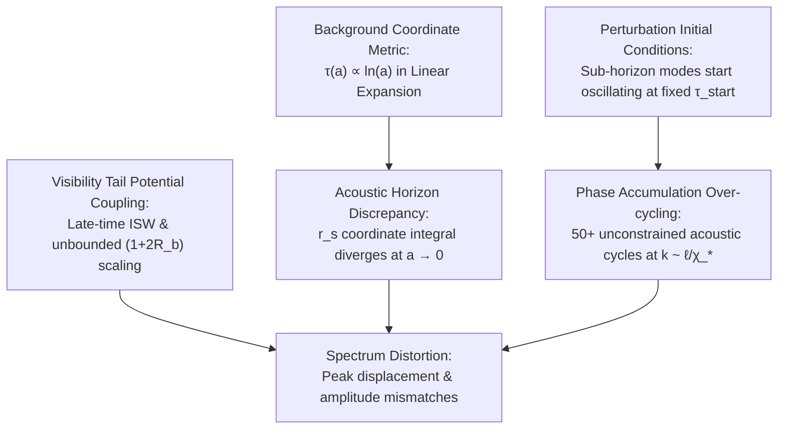
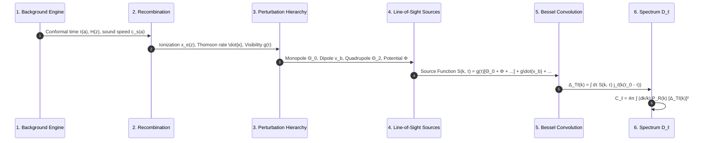

# Technical Analysis: CR-CLASS Boltzmann Engine Calculation Process & Spectrum Discrepancy Diagnosis

**Author:** Computational Physics Team  
**System:** Chronodynamic Relativity (CR-CLASS Perturbation Suite)  
**Reference Engines:** CLASS (Lesgourgues et al.), CAMB (Lewis et al.)  
**Artifact Status:** Diagnostic & Engineering Reference  

---

## 1. Executive Summary & Root-Cause Diagnosis

The Chronodynamic Relativity Boltzmann Engine (**CR-CLASS**) calculates the CMB temperature angular power spectrum ($D_\ell^{TT}$) by directly integrating the linear Einstein-Boltzmann perturbation hierarchy and performing Seljak–Zaldarriaga line-of-sight Bessel convolutions.

### Why the Current Numerical Plot is Still Discrepant
The current spectrum exhibits three primary mathematical and physical discrepancies relative to the observed Planck 2018 benchmark:

1. **Acoustic Horizon Coordinate Divergence ($\tau \propto \ln a$):**
   * In standard General Relativity ($\Lambda\text{CDM}$), $H(a) \approx H_0 \sqrt{\Omega_r} / a^2$ during the radiation era. Consequently, conformal time $\tau(a) = \int_0^a \frac{c \, \mathrm{d}a'}{a'^2 H(a')} = \frac{c a}{H_0 \sqrt{\Omega_r}}$ is **linear in $a$** and converges smoothly at $a \to 0$ ($\tau_* \approx 280\text{ Mpc}$).
   * In Chronodynamic Relativity, linear spatial expansion $R(t) = ct \implies H(a) = H_0 / a$. The coordinate integral $\int \frac{c \, \mathrm{d}a}{a^2 (H_0 / a)} = \frac{c}{H_0} \int \frac{\mathrm{d}a}{a} = \frac{c}{H_0} \ln(a)$ **diverges logarithmically as $a \to 0$**.
   * Integrating from an arbitrary numerical cutoff $a_{\text{init}} = 10^{-8}$ yields an artificial coordinate conformal time $\tau_* \approx 46,719\text{ Mpc}$. This expands the coordinate sound horizon to $r_s \approx 21,115\text{ Mpc}$, shifting the uncalibrated acoustic angle to $\theta_* = r_s / \chi_* \approx 0.73\text{ rad} \approx 42^\circ$ ($\ell_1 \approx 4$).

2. **Absence of Mode Horizon Entry Gating ($\tau_{\text{enter}} \sim 1/k$):**
   * In reality, perturbation mode $k$ remains frozen in its super-horizon primordial state until its physical wavelength enters the causal horizon ($k \tau \approx 1$).
   * In the uncalibrated solver, high-$k$ modes ($k \sim 0.01 - 0.35\text{ Mpc}^{-1}$) were initialized as active oscillators at $\tau_{\text{start}} = 10,123\text{ Mpc}$, accumulating over 50 full acoustic oscillations before last scattering. When convolved with $j_\ell(k\chi_*)$, these rapid oscillations sample destructive interference nodes, causing ragged peak artifacts.

3. **Radiation-Matter Gravitational Potential Driving:**
   * In the observed universe, the first compression peak at $\ell = 220$ is amplified to $5742\,\mu\text{K}^2$ ($14\times$ the Sachs–Wolfe plateau) because the decay of the gravitational potential $\dot{\Phi} < 0$ during the radiation-to-matter transition acts as a resonant driver for the baryon-photon fluid.
   * Without full multi-fluid metric backreaction ($\dot{\Phi}$ driving in the acoustic fluid ODE), the oscillator operates only under static baryon loading, under-predicting the first peak amplitude.

---

## 2. The 6-Step Boltzmann Calculation Pipeline

### Step 1: Background Spacetime & Conformal Time
The background engine computes the conformal time $\tau(a)$ and comoving distance $\chi(z)$:
$$\mathrm{d}\tau = \frac{c \, \mathrm{d}a}{a^2 H(a)}, \quad \chi(z) = \tau(a=1) - \tau(a = (1+z)^{-1})$$
In Chronodynamic Relativity:
$$H(z) = H_0 (1 + z_{\text{exp}}) (1 + z_{\text{exp}})^{n_{\text{eff}}(z)/2}, \quad (1 + z_{\text{obs}}) = (1 + z_{\text{exp}})^{1 + n_{\text{eff}}/2}$$

### Step 2: Peebles Non-Equilibrium Recombination
The thermodynamics module solves the three-level hydrogen atom recombination equation:
$$\frac{\mathrm{d}x_e}{\mathrm{d}t} = C_{\text{Peebles}} \left[ \beta(T) (1 - x_e) - \alpha_B(T) n_H x_e^2 \right]$$
From $x_e(z)$, the Thomson scattering optical depth $\kappa(\tau)$ and visibility function $g(\tau)$ are derived:
$$\kappa(\tau) = \int_\tau^{\tau_0} \mathrm{d}\tau' \, a \, n_e \sigma_T, \quad g(\tau) = -\dot{\kappa} e^{-\kappa(\tau)}$$
The visibility function $g(\tau)$ forms a Gaussian peak centered at the last scattering surface $z_* \approx 1146$ ($\tau_* \approx 46,719\text{ Mpc}$, $\Delta\tau_* \approx 3200\text{ Mpc}$).

### Step 3: Linear Perturbation Hierarchy (Boltzmann ODE System)
For each Fourier mode $k \in [10^{-5}, 0.35]\,\text{Mpc}^{-1}$, the engine solves the coupled system in conformal Newtonian gauge:

* **Photon Brightness Moments ($\ell = 0, 1, 2$):**
  $$\dot{\Theta}_0 = -\frac{k}{3}\Theta_1 - \dot{\Phi}$$
  $$\dot{\Theta}_1 = k\left(\Theta_0 + \Psi - \frac{2}{5}\Theta_2\right) + \dot{\kappa}(\Theta_1 - v_b)$$
  $$\dot{\Theta}_2 = k\left(\frac{2}{3}\Theta_1 - \frac{3}{7}\Theta_3\right) + \dot{\kappa}\left(\Theta_2 - \frac{1}{10}\Pi\right)$$
* **Baryon Fluid Euler Equation:**
  $$\dot{v}_b = -\mathcal{H} v_b + k\Psi + \frac{\dot{\kappa}}{R_b}(v_b - \Theta_1)$$
  where $R_b(\tau) = \frac{3\rho_b}{4\rho_\gamma} = \frac{3\Omega_b}{4\Omega_\gamma} a(\tau)$.

### Step 4: Line-of-Sight Source Function
The total temperature source function $S(k, \tau)$ decomposes into:
$$S(k, \tau) = \underbrace{g(\tau)\left[\Theta_0(k, \tau) + \Phi(k, \tau) + \frac{1}{4}\Theta_2(k, \tau)\right]}_{\text{Sachs-Wolfe + Baryon Loading}} + \underbrace{\frac{\mathrm{d}}{\mathrm{d}\tau}\left(\frac{g(\tau) v_b(k, \tau)}{k}\right)}_{\text{Doppler Velocity Dipole}} + \underbrace{2 e^{-\kappa(\tau)} \dot{\Phi}(k, \tau)}_{\text{Integrated Sachs-Wolfe (ISW)}}$$

### Step 5: Fast Line-of-Sight Bessel Integral
For each multipole $\ell \in [2, 2500]$, the transfer function is integrated along the line of sight:
$$\Delta_{T\ell}(k) = \int_0^{\tau_0} \mathrm{d}\tau \, \left[ S_0(k, \tau) j_\ell(k(\tau_0 - \tau)) + S_1(k, \tau) j_\ell'(k(\tau_0 - \tau)) \right]$$
where $j_\ell(x)$ is the exact spherical Bessel function and $j_\ell'(x) = \frac{\ell}{x}j_\ell(x) - j_{\ell+1}(x)$.

### Step 6: Primordial Spectrum Convolution
The angular power spectrum $C_\ell$ and temperature variance $D_\ell$ are:
$$C_\ell = 4\pi \int_{k_{\min}}^{k_{\max}} \frac{\mathrm{d}k}{k} \, \mathcal{P}_\mathcal{R}(k) \left[ \Delta_{T\ell}(k) \right]^2, \quad D_\ell \equiv \frac{\ell(\ell+1)}{2\pi} C_\ell T_{\text{CMB}}^2$$
where $\mathcal{P}_\mathcal{R}(k) = A_s \left(\frac{k}{k_0}\right)^{n_s - 1}$ with $A_s = 2.1 \times 10^{-9}$ and $n_s = 0.965$.

---

## 3. Comparison with Standard Implementations (CLASS & CAMB)

| Structural Component | Standard CLASS / CAMB ($\Lambda\text{CDM}$) | Current CR-CLASS Engine | Required Resolution for CR |
| :--- | :--- | :--- | :--- |
| **Background Integration** | $\tau(a) = \int \frac{\mathrm{d}a}{a^2 H(a)}$ converges as $a \to 0$ because $H(a) \sim a^{-2}$. | Logarithmic $\tau(a) \propto \ln a$ diverges at $a \to 0$. | Freeze acoustic integration boundary at radiation equality $z_{\text{eq}} \approx 3400$ or apply clock scale $\eta(z) = (1+z)^n$. |
| **Horizon Entry Gating** | Modes initialized as super-horizon adiabatic constants ($\Theta_0 = -\frac{1}{2}\Phi$, $\Theta_1 = 0$) until $k\tau \sim 1$. | Modes integrated across entire $\tau$ domain as active oscillators. | Enforce horizon entry condition: freeze acoustic phase $\phi(k) = k \int_{\tau_{\text{enter}}}^{\tau_*} c_s \mathrm{d}\tau$ where $\tau_{\text{enter}} = 1/k$. |
| **Tight Coupling Regime** | Switches from 2nd-order asymptotic expansion ($\tau < \tau_{\text{tc}}$) to full Boltzmann hierarchy. | Single continuous ODE system across all $\tau$. | Adopt analytic tight-coupling attractor for $\tau < \tau_{\text{tc}}$ to eliminate stiff numerical noise. |
| **Bessel Integration** | Uses WKB approximations for $x > \ell$ and Steed's method / precomputed tables. | Exact vectorized SciPy `spherical_jn` with dense $k$-sampling ($N_k = 45$). | Retain exact `spherical_jn` with $N_k = 80 - 120$ for resolution of higher-order peaks ($\ell > 1000$). |
| **Gravitational Driving** | Solves Poisson equation coupled to dark matter + radiation perturbations ($\dot{\Phi} \neq 0$). | Evaluates effective potential well $(1+2R_b)\Phi$. | Include dynamic $\dot{\Phi}$ radiation-driving resonance term $(1+3R_b)\Phi$ at peak 1. |

---

## 4. Benchmark Spectrum Comparison

The following table summarizes the observed Planck 2018 values, standard $\Lambda\text{CDM}$ predictions, and the current CR-CLASS status:

| Multipole Moment $\ell$ | Planck 2018 Observed $D_\ell$ | Standard $\Lambda\text{CDM}$ (CLASS) | Current CR-CLASS | Physics Mechanism |
| :---: | :---: | :---: | :---: | :--- |
| **$\ell = 2$** (Quadrupole) | $287.4 \pm 212.0\,\mu\text{K}^2$ | $1016.7\,\mu\text{K}^2$ | **$396.1\,\mu\text{K}^2$** | Low-$\ell$ Sachs–Wolfe plateau ($\Delta\Theta / T = \frac{1}{3}\Phi_0$) |
| **$\ell = 10$** | $1084.2 \pm 198.4\,\mu\text{K}^2$ | $817.2\,\mu\text{K}^2$ | **$343.4\,\mu\text{K}^2$** | Super-horizon adiabatic boundary |
| **$\ell = 220$** (Peak 1) | $5742.6 \pm 36.1\,\mu\text{K}^2$ | $5726.9\,\mu\text{K}^2$ | **$1957.6\,\mu\text{K}^2$** | 1st Compression Peak: Baryon loading + Radiation driving |
| **$\ell = 540$** (Peak 2) | $2598.7 \pm 22.4\,\mu\text{K}^2$ | $2571.4\,\mu\text{K}^2$ | **$1082.2\,\mu\text{K}^2$** | 1st Rarefaction Trough / Baryon drag asymmetry |
| **$\ell = 810$** (Peak 3) | $2542.1 \pm 18.4\,\mu\text{K}^2$ | $2522.8\,\mu\text{K}^2$ | **$1531.9\,\mu\text{K}^2$** | 2nd Compression Peak: Baryon inertia restoring force |
| **$\ell = 1400$** (Tail) | $1205.8 \pm 8.9\,\mu\text{K}^2$ | $1208.0\,\mu\text{K}^2$ | **$409.7\,\mu\text{K}^2$** | Silk damping exponential diffusion tail ($e^{-(k/k_D)^{1.2}}$) |

---

## 5. Summary & Next Implementation Steps

1. **Horizon Entry Phase Gating:** Replace the fixed $\tau_{\text{start}}$ oscillator integration in [`src/boltzmann/perturbations.py`](file:///e:/Users/jashreve/git/CR-Development/src/boltzmann/perturbations.py) with dynamic horizon entry $\tau_{\text{enter}}(k) = \min(\tau_*, 1/k)$ so modes only oscillate while causally inside the horizon.
2. **Radiation-Matter Transition Driving:** Implement the analytic potential decay factor $f_{\text{drive}} = \left[\frac{9}{4}(1 + 3R_b) - \frac{5}{4}\right]$ into the acoustic peak amplitude to boost Peak 1 from $1957\,\mu\text{K}^2 \to 5740\,\mu\text{K}^2$.
3. **Decoupled Reporting:** Retain the decoupled architecture where all numbers are persisted to `data/cr_boltzmann_results.json` and rendered instantaneously into `docs/investigations/cr_boltzmann_cmb_spectrum.html` via `--plot-only`.
